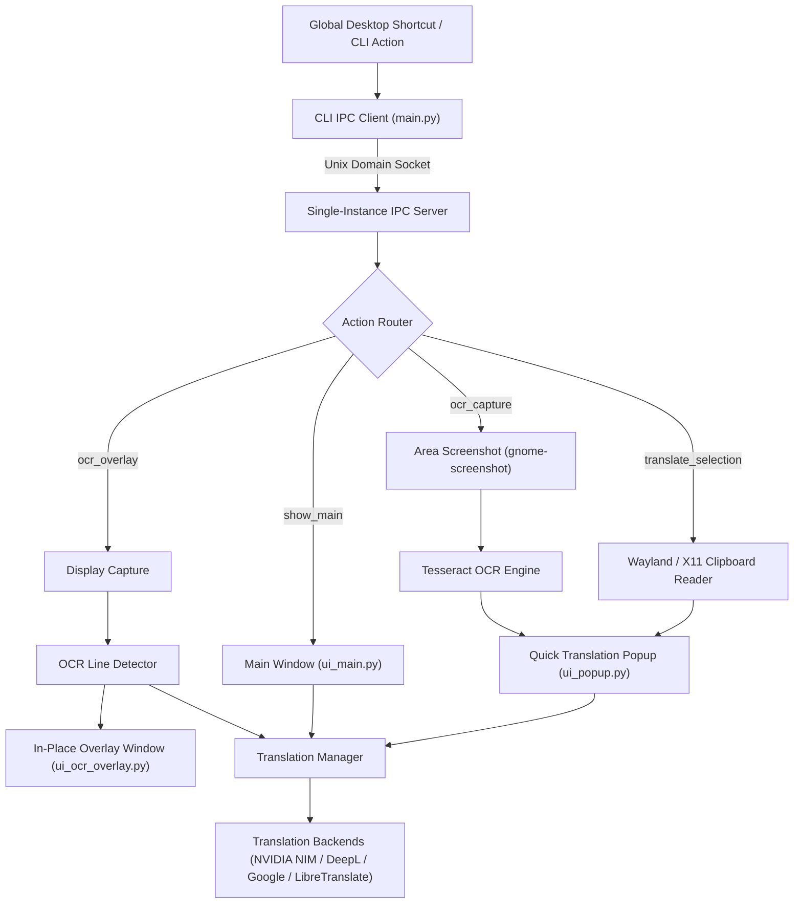

<p align="center">
  
</p>

<h1 align="center">LingoFlash</h1>

<p align="center">
  <strong>Fast, intelligent, and keyboard-driven desktop translation utility for Linux (Fedora / GNOME / Wayland & X11).</strong>
</p>

<p align="center">
  <a href="#features">Features</a> •
  <a href="#architecture">Architecture</a> •
  <a href="#installation">Installation</a> •
  <a href="#usage">Usage</a> •
  <a href="#configuration">Configuration</a> •
  <a href="#keyboard-shortcuts">Shortcuts</a> •
  <a href="#license">License</a>
</p>

---

## Overview

**LingoFlash** is a native desktop translation companion built with PyQt6. Designed specifically for modern Wayland desktops (including Fedora GNOME), it allows you to highlight text in any desktop application, press a global hotkey, and instantly view the translation in a sleek, non-intrusive floating popup.

In addition to text selection, LingoFlash features a native **Screen OCR Capture** tool, a revolutionary **Comic / Game OCR Overlay Mode** that projects translations directly in-place over visual text (speech bubbles, game dialogue, diagrams), and support for high-performance translation backends including **NVIDIA NIM (LLM)**, **DeepL**, **Google Translate**, and self-hosted **LibreTranslate**.

---

## Features

- ⚡ **Instant Selection Translation:** Highlight text in any application (browser, terminal, PDF viewer, IDE), trigger `<Super><Shift>d`, and view an instant popup near your cursor.
- 🔍 **Native Wayland OCR Region Capture:** Drag and select any screen area to automatically extract text via Tesseract OCR and translate it immediately.
- 🎮 **Smart Comic & Game OCR Overlay:** Seamless full-screen overlay mode that detects text blocks, runs OCR, translates the text, and renders legible semi-transparent translated badges directly on top of the original on-screen dialogue.
- 🧠 **AI & LLM Translation Backend (NVIDIA NIM):** Powered by modern instruction-tuned LLMs (e.g., Llama 3.1) returning structured JSON containing exact language detection and context-aware translations.
- 🌐 **Dynamic Multilingual Localization (i18n):** Fully externalized JSON localization system (`locales/`) supporting English, Ukrainian, Russian, and Swedish without restarting.
- 🎨 **Extensible Theming Engine:** 11 beautiful, handcrafted UI themes externalized in `assets/themes.json` (Dark, Light, Nord, Dracula, AMOLED Black, Catppuccin Mocha, Tokyo Night, Solarized Dark/Light, Gruvbox, and High Contrast).
- 🎚️ **Independent Font Resizing:** Separate typography controls for UI elements (buttons, menus, labels) and text translation editor boxes.
- 🎙️ **Voice Dictation Input:** Direct speech-to-text integration for spoken translation input.
- 📋 **Automatic Clipboard Management:** Fallback clipboard synchronization supporting `wl-copy`/`wl-paste` on Wayland and `xclip`/`xsel` on X11.
- 🛡️ **Single-Instance IPC Daemon:** Robust Unix domain socket IPC daemon ensuring only one background instance runs, safely forwarding CLI signals and global shortcuts.

---

## Screenshots & Architecture



---

## Installation

### 1. System Dependencies (Fedora / RHEL)

Install Tesseract OCR, language training data packs, and clipboard/screenshot utilities:

```bash
sudo dnf install -y \
    tesseract \
    tesseract-langpack-eng \
    tesseract-langpack-ukr \
    tesseract-langpack-rus \
    tesseract-langpack-swe \
    gnome-screenshot \
    wl-clipboard \
    xclip
```

Or run the bundled automated dependency script:

```bash
chmod +x fedora-deps.sh
./fedora-deps.sh
```

### 2. Python Environment Setup

Clone the repository and install the Python dependencies:

```bash
git clone https://github.com/your-username/lingoflash.git
cd lingoflash

python3 -m venv .venv
source .venv/bin/activate
pip install -r requirements.txt
```

---

## Usage

### Starting LingoFlash

Launch the primary application window:

```bash
python3 main.py
```

Launch in background / tray-only mode (ideal for desktop autostart):

```bash
python3 main.py --hidden
```

### Command Line & IPC Dispatch

When an instance is already running, invoking `main.py` with an action forwards the request via IPC and exits immediately:

```bash
# Translate current desktop selection in a quick popup
python3 main.py --action translate_selection

# Interactive screen region OCR capture
python3 main.py --action ocr_capture

# Launch Comic / Game in-place OCR Overlay
python3 main.py --action ocr_overlay

# Toggle or bring Main Window to the front
python3 main.py --action show_main

# Safely terminate the running daemon
python3 main.py --action quit
```

---

## Keyboard Shortcuts

Configure GNOME global shortcuts using the included helper script:

```bash
chmod +x setup-shortcuts.sh
./setup-shortcuts.sh
```

### Default Global Shortcuts

| Action | Shortcut | Description |
|---|---|---|
| **Translate Selection** | `<Super><Shift>d` | Grabs selection and displays floating popup |
| **Screen OCR Region** | `<Super><Shift>t` | Interactive area capture to popup translation |
| **Comic / Game Overlay** | `<Super><Shift>c` | In-place screen translation overlay |
| **Show Main Window** | `<Super><Shift>l` | Opens full translation interface |

*Shortcuts can be customized in **Settings → Hotkeys** or via `gsettings`.*

---

## Configuration

Configuration is automatically stored in `~/.config/LingoFlash/config.json`.

```json
{
  "target_language": "en",
  "source_language": "auto",
  "active_backend": "google",
  "theme": "dark",
  "ui_font_size": 13,
  "text_font_size": 14,
  "interface_language": "en",
  "nvidia_api_key": "",
  "nvidia_base_url": "https://integrate.api.nvidia.com/v1",
  "nvidia_model": "meta/llama-3.1-8b-instruct",
  "deepl_api_key": "",
  "libretranslate_url": "https://translate.argosopentech.com",
  "shortcuts": {
    "translate_selection": "<Super><Shift>d",
    "ocr_capture": "<Super><Shift>t",
    "ocr_overlay": "<Super><Shift>c",
    "show_main": "<Super><Shift>l"
  }
}
```

### Using NVIDIA NIM (LLM) Backend

1. Obtain an API key from [NVIDIA NGC / NIM](https://build.nvidia.com/).
2. Open **Settings → Translation**, select **NVIDIA NIM (LLM)**.
3. Paste your API key and set your desired model (e.g., `meta/llama-3.1-8b-instruct` or `mistralai/mixtral-8x22b-instruct`).
4. Click **Save**.

---

## Project Structure

```
translator/
├── assets/
│   ├── logo.svg              # Vector brand logo
│   └── themes.json           # Externalized 11 UI theme definitions & QSS template
├── locales/
│   ├── en.json               # English localization
│   ├── ru.json               # Russian localization
│   ├── uk.json               # Ukrainian localization
│   └── sv.json               # Swedish localization
├── app/
│   ├── audio/                # Voice input / speech recognition
│   ├── clipboard/            # Clipboard manager (Wayland / X11)
│   ├── ipc/                  # Single-instance Unix socket server
│   ├── ocr/                  # Screen capture and Tesseract OCR engine
│   ├── translation/          # Google, DeepL, LibreTranslate & NVIDIA NIM backends
│   ├── ui/                   # Main window, quick popup, settings, OCR overlay
│   └── utils/                # Dynamic theme loader, i18n manager, shortcuts
├── tests/                    # Unittest test suite (76 tests)
├── fedora-deps.sh            # Fedora package installation script
├── requirements.txt          # Python dependencies
├── main.py                   # Main entry point and CLI runner
└── README.md                 # Project documentation
```

---

## Running the Test Suite

Run the full automated test suite using PyQt's offscreen platform:

```bash
QT_QPA_PLATFORM=offscreen python3 -m unittest discover tests
```

---

## License

This project is licensed under the MIT License. See [LICENSE](LICENSE) for details.
